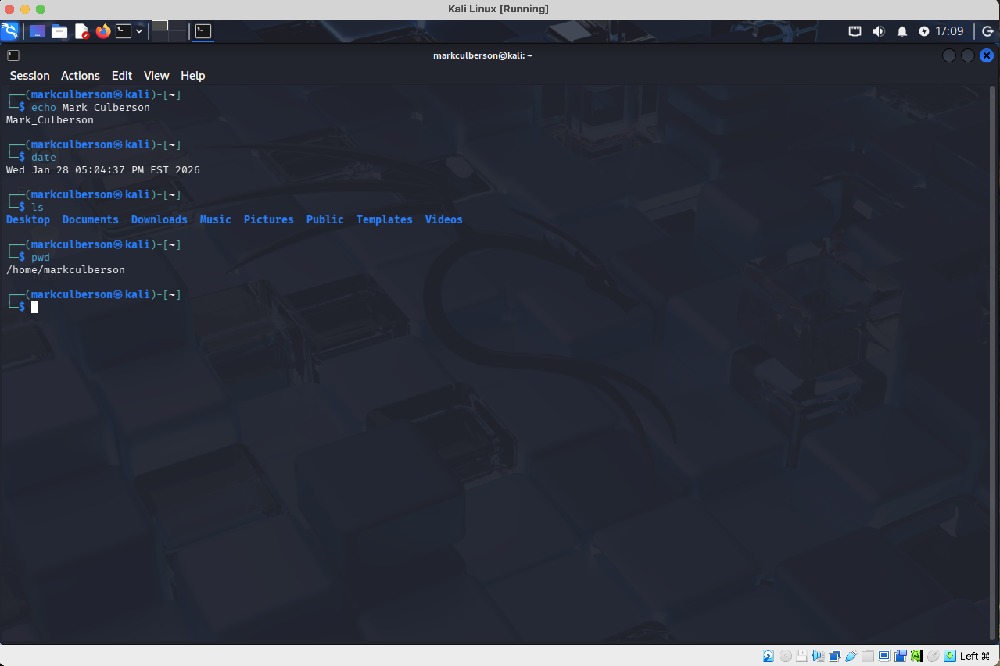

# Linux Command Fundamentals

**Course:** CYSE 270 — Linux System for Cybersecurity, Old Dominion University  
**Evidence type:** Screenshots extracted from a submitted coursework PDF.  
**Source:** `linux description of the four commands (1).pdf` (not included in this public-facing package).

## Project overview
Used echo, date, ls, and pwd in a Kali Linux terminal and explained their purpose.

## Technical observations
Basic command fluency supports repeatable administration and verification of a Linux environment.

## Evidence gallery

## Evidence and limitations
This description was drafted from the submitted PDF and its screenshots. It is a portfolio explanation, **not** a verbatim original lab reflection. Any screenshots may show mistakes or intermediate states; they are not proof of production readiness. Original editable source files were not provided.

**Before publication:** inspect all images for usernames, student IDs, passwords, hashes, network identifiers, and other sensitive details. Remove or redact as needed.
