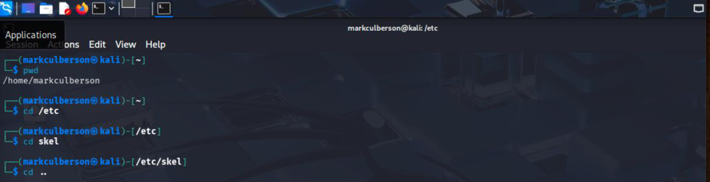
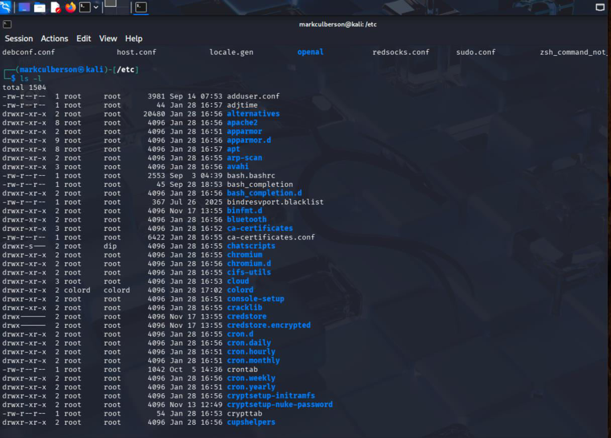
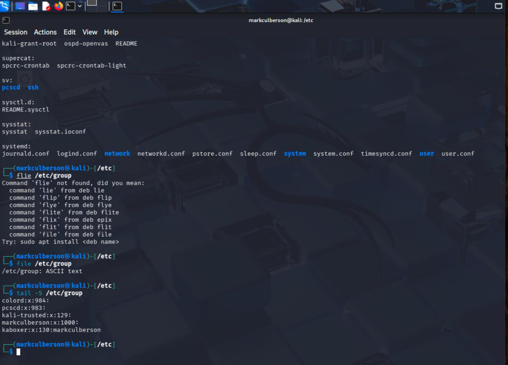
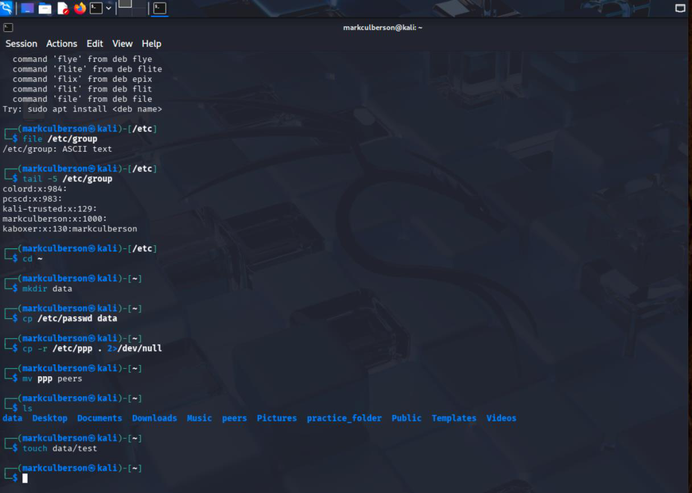

# Linux Command Line and File Operations

**Course:** CYSE 270 — Linux System for Cybersecurity, Old Dominion University  
**Evidence type:** Screenshots extracted from a submitted coursework PDF.  
**Source:** `CYSE 270 - Assignment 2-Working with Command Line (1)(1).pdf` (not included in this public-facing package).

## Project overview
Navigated the Linux filesystem using absolute and relative paths, inspected directory listings and system files, and practiced creating, copying, renaming, and removing files and directories.

## Technical observations
The terminal captures document hands-on use of filesystem commands. The distinction between absolute and relative paths matters when troubleshooting scripts and system configurations.

## Evidence gallery

## Evidence and limitations
This description was drafted from the submitted PDF and its screenshots. It is a portfolio explanation, **not** a verbatim original lab reflection. Any screenshots may show mistakes or intermediate states; they are not proof of production readiness. Original editable source files were not provided.

