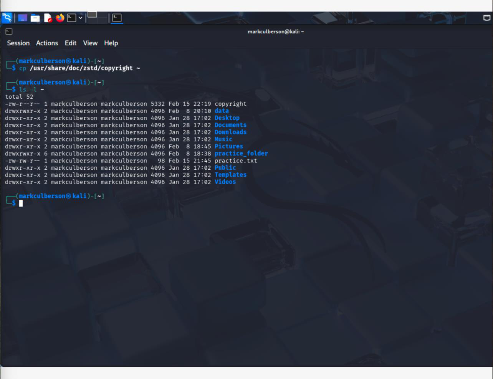
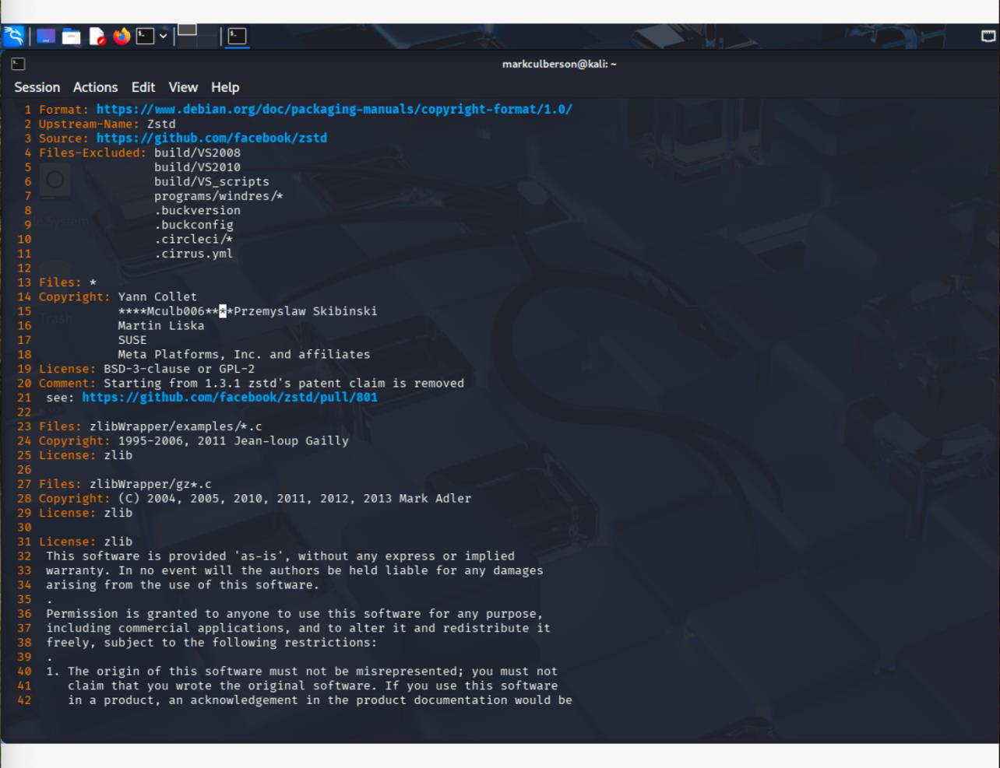
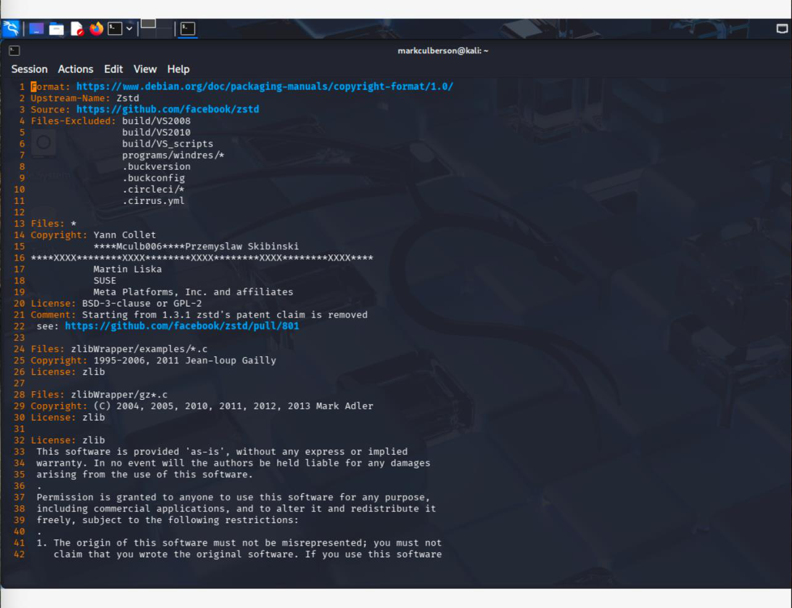
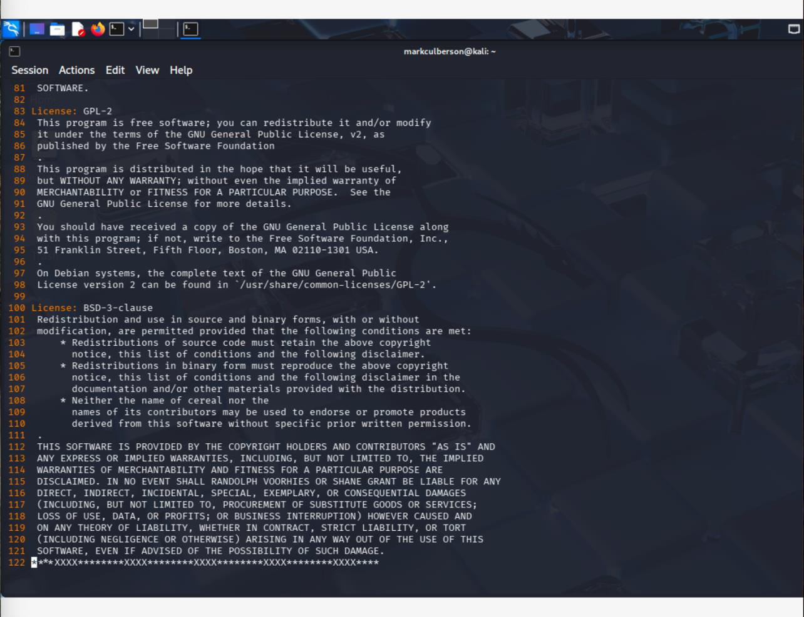

# Editing Linux Files with vi

**Course:** CYSE 270 — Linux System for Cybersecurity, Old Dominion University  
**Evidence type:** Screenshots extracted from a submitted coursework PDF.  
**Source:** `Assignment 3-Working with VI Editor-1.pdf` (not included in this public-facing package).

## Project overview
Used vi to navigate and edit a text file, practice command and insert modes, search text, and save changes.

## Technical observations
Terminal-based editing is useful when managing remote Linux hosts where graphical editors are unavailable.

## Evidence gallery

## Evidence and limitations
This description was drafted from the submitted PDF and its screenshots. It is a portfolio explanation, **not** a verbatim original lab reflection. Any screenshots may show mistakes or intermediate states; they are not proof of production readiness. Original editable source files were not provided.

**Before publication:** inspect all images for usernames, student IDs, passwords, hashes, network identifiers, and other sensitive details. Remove or redact as needed.
