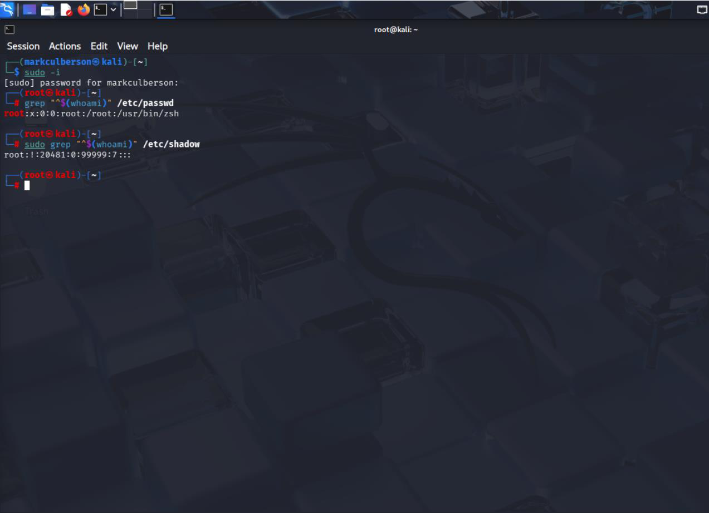
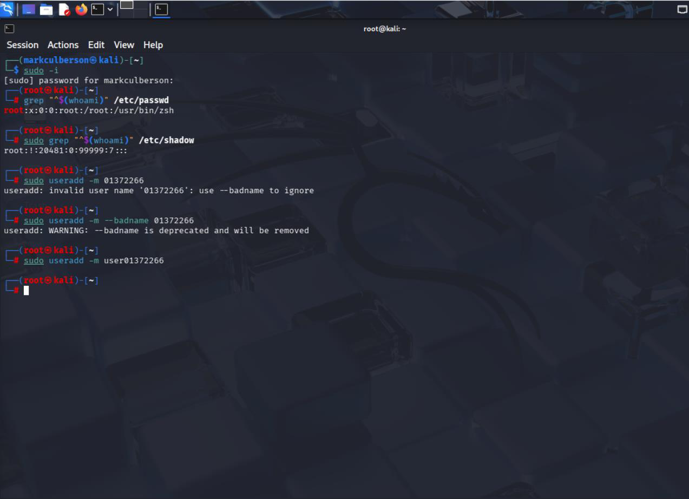
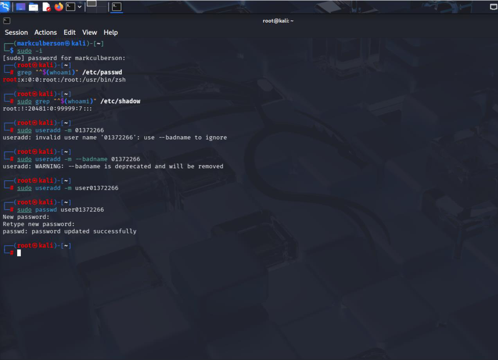
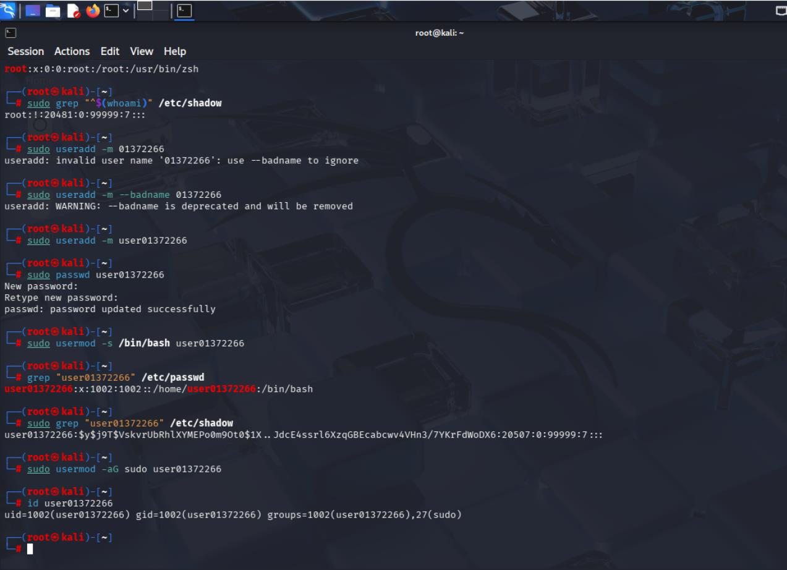

# Linux User and Group Administration

**Course:** CYSE 270 — Linux System for Cybersecurity, Old Dominion University  
**Evidence type:** Screenshots extracted from a submitted coursework PDF.  
**Source:** `Assignment 4 - User and Group .pdf` (not included in this public-facing package).

## Project overview
Practiced user creation, password configuration, shell selection, group membership changes, and verification using Linux account databases.

## Technical observations
Identity and group management demonstrate the foundation of least privilege and system access administration. Screenshots include attempts and corrections, which should be interpreted as troubleshooting evidence rather than flawless execution.

## Evidence gallery

## Evidence and limitations
This description was drafted from the submitted PDF and its screenshots. It is a portfolio explanation, **not** a verbatim original lab reflection. Any screenshots may show mistakes or intermediate states; they are not proof of production readiness. Original editable source files were not provided.

**Before publication:** inspect all images for usernames, student IDs, passwords, hashes, network identifiers, and other sensitive details. Remove or redact as needed.
