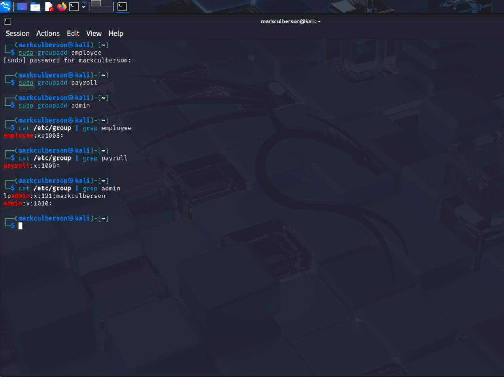
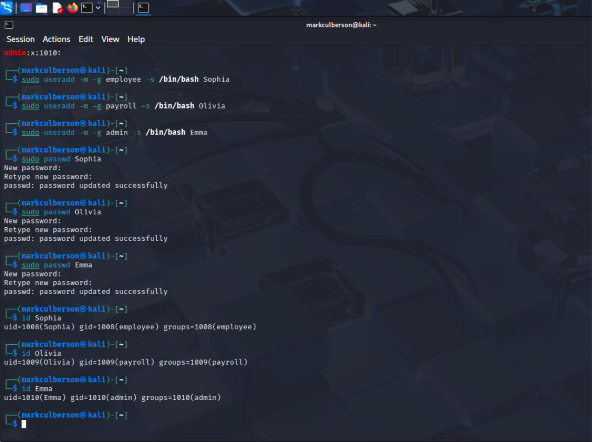
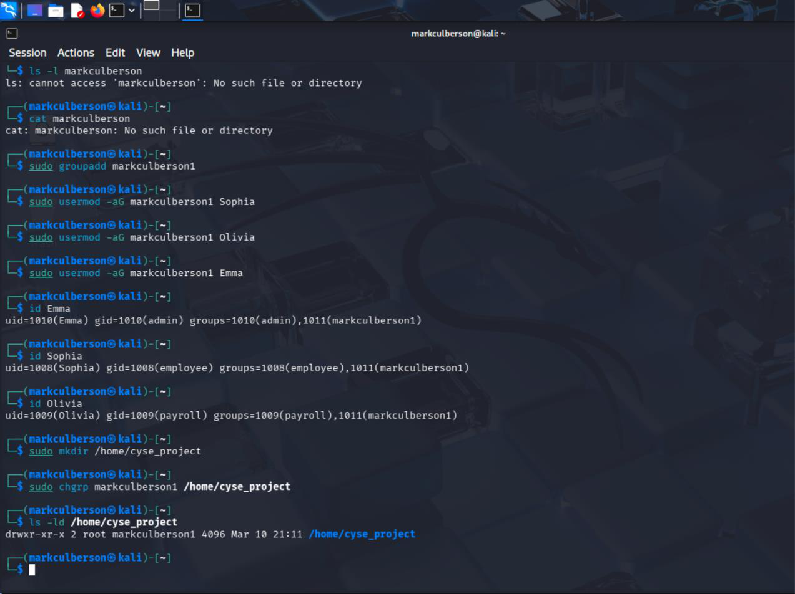
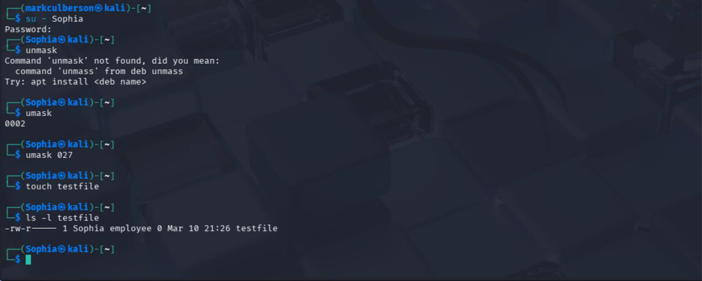

# Linux File Permissions and Shared Access

**Course:** CYSE 270 — Linux System for Cybersecurity, Old Dominion University  
**Evidence type:** Screenshots extracted from a submitted coursework PDF.  
**Source:** `Lab 6 File Permission (completed assignment).pdf` (not included in this public-facing package).

## Project overview
Created user and group accounts and configured a shared directory, working with Unix permission bits, ownership, umask, and group-based access.

## Technical observations
The exercise illustrates how directory permissions and group inheritance influence collaboration and access control. Screenshots show both successful commands and troubleshooting.

## Evidence gallery

## Evidence and limitations
This description was drafted from the submitted PDF and its screenshots. It is a portfolio explanation, **not** a verbatim original lab reflection. Any screenshots may show mistakes or intermediate states; they are not proof of production readiness. Original editable source files were not provided.

**Before publication:** inspect all images for usernames, student IDs, passwords, hashes, network identifiers, and other sensitive details. Remove or redact as needed.
