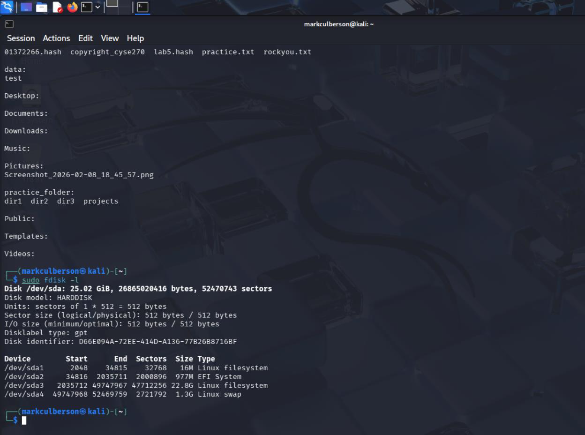
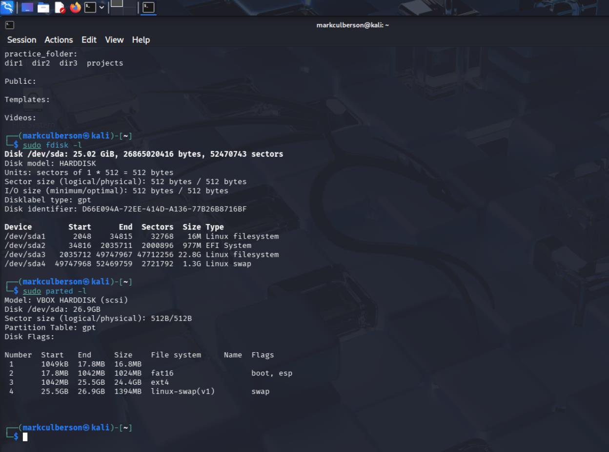
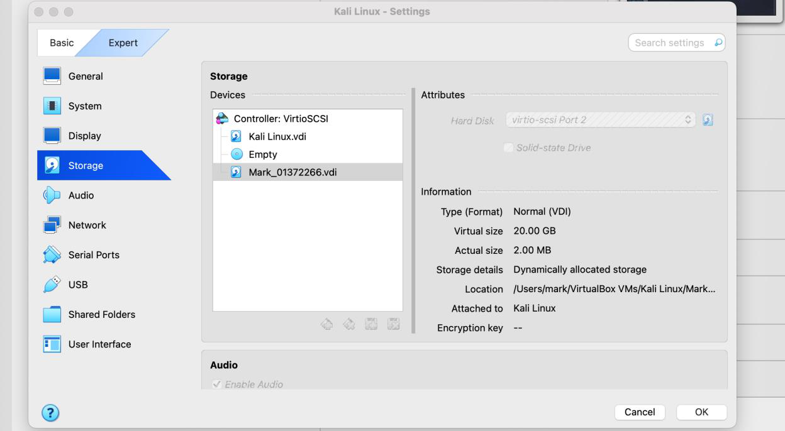
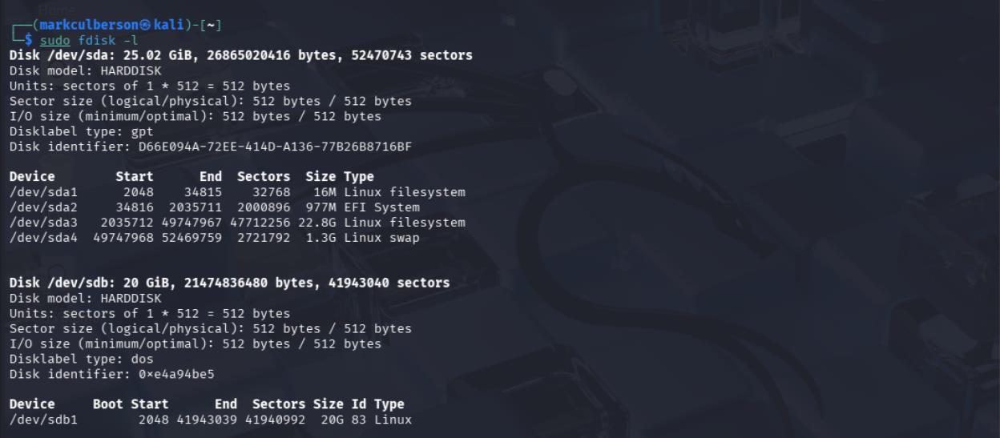

# Linux Virtual Disk and Filesystem Management

**Course:** CYSE 270 — Linux System for Cybersecurity, Old Dominion University  
**Evidence type:** Screenshots extracted from a submitted coursework PDF.  
**Source:** `Lab 7 – Manage Local Storage(20261108-011615).pdf` (not included in this public-facing package).

## Project overview
Inspected partitions using fdisk and parted, worked with a virtual disk, and practiced filesystem and mount operations.

## Technical observations
Storage administration requires verifying the target device before changing partitions; incorrect device selection can destroy data. The screenshots include intermediate states and should not be interpreted as a fully validated production procedure.

## Evidence gallery

## Evidence and limitations
This description was drafted from the submitted PDF and its screenshots. It is a portfolio explanation, **not** a verbatim original lab reflection. Any screenshots may show mistakes or intermediate states; they are not proof of production readiness. Original editable source files were not provided.

**Before publication:** inspect all images for usernames, student IDs, passwords, hashes, network identifiers, and other sensitive details. Remove or redact as needed.
