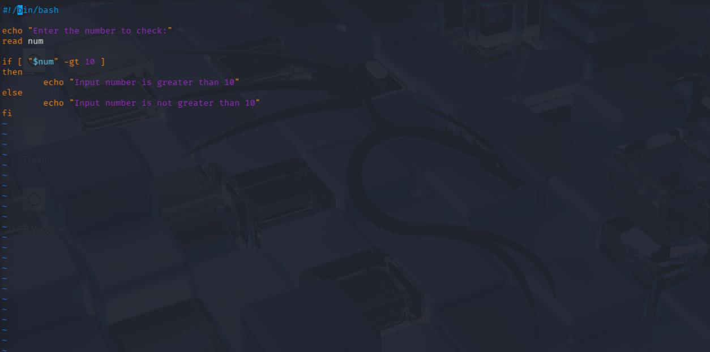
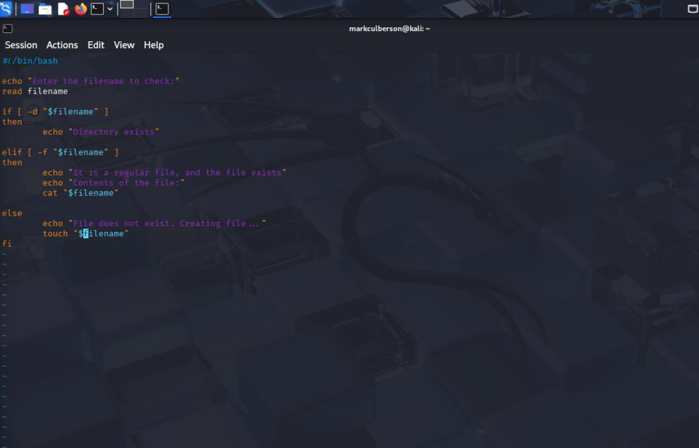
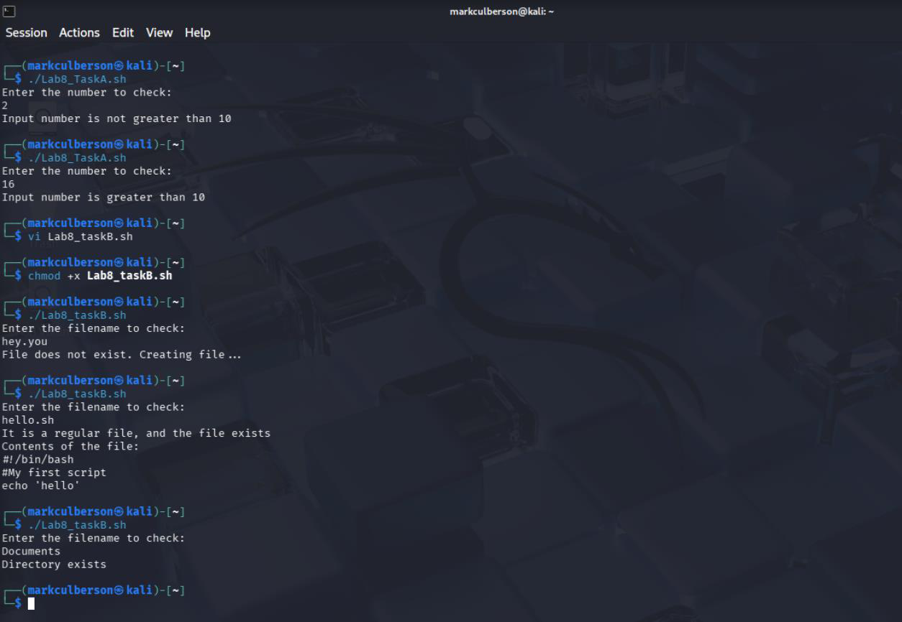
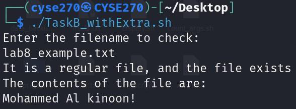

# Bash Conditional Logic and File Checks

**Course:** CYSE 270 — Linux System for Cybersecurity, Old Dominion University  
**Evidence type:** Screenshots extracted from a submitted coursework PDF.  
**Source:** `Lab 8 - Shell Scripting(20261108-011619).pdf` (not included in this public-facing package).

## Project overview
Created Bash scripts using input prompts, if/else logic, file-versus-directory checks, and execution permissions.

## Technical observations
Input validation and file tests are useful building blocks for administrative automation. The screenshots provide code and output evidence, but the original editable .sh files were not uploaded.

## Evidence gallery

## Evidence and limitations
This description was drafted from the submitted PDF and its screenshots. It is a portfolio explanation, **not** a verbatim original lab reflection. Any screenshots may show mistakes or intermediate states; they are not proof of production readiness. Original editable source files were not provided.

**Before publication:** inspect all images for usernames, student IDs, passwords, hashes, network identifiers, and other sensitive details. Remove or redact as needed.
