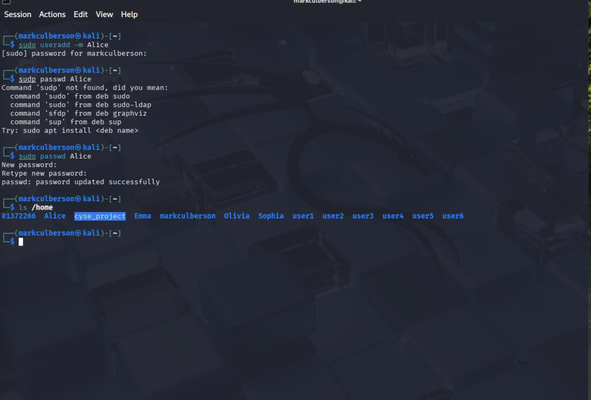
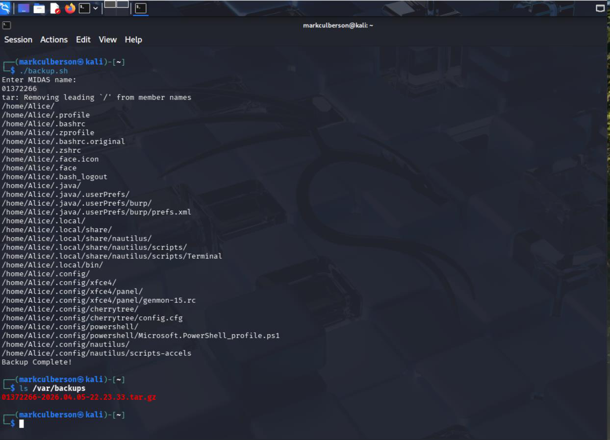
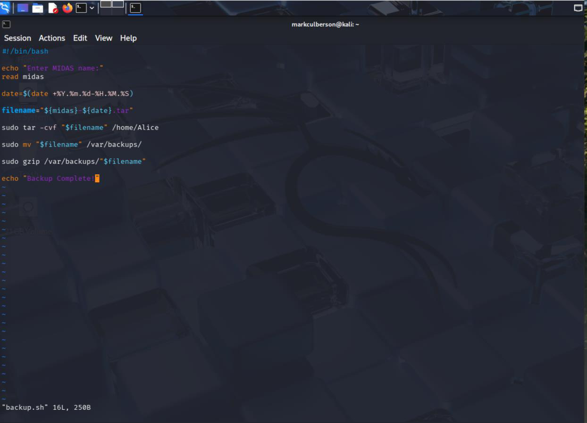
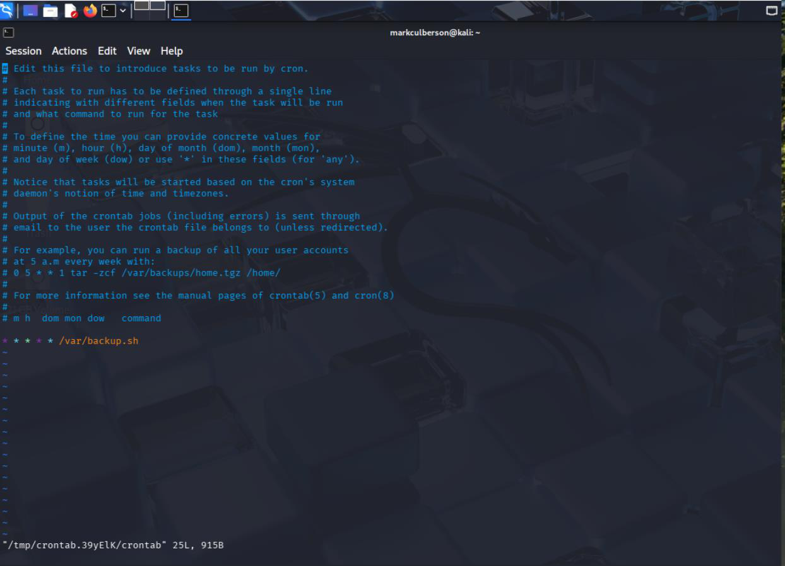

# Scheduled Linux Backups with cron

**Course:** CYSE 270 — Linux System for Cybersecurity, Old Dominion University  
**Evidence type:** Screenshots extracted from a submitted coursework PDF.  
**Source:** `Lab 9 - Task Automation(1).pdf` (not included in this public-facing package).

## Project overview
Worked on a shell-based backup workflow that archives a lab user home directory and uses cron to schedule execution.

## Technical observations
Automated backups reduce manual effort, but real-world designs also need retention, restoration tests, monitoring, and access controls. The submission includes evidence of archive creation and scheduled-task work.

## Evidence gallery

## Evidence and limitations
This description was drafted from the submitted PDF and its screenshots. It is a portfolio explanation, **not** a verbatim original lab reflection. Any screenshots may show mistakes or intermediate states; they are not proof of production readiness. Original editable source files were not provided.

**Before publication:** inspect all images for usernames, student IDs, passwords, hashes, network identifiers, and other sensitive details. Remove or redact as needed.
