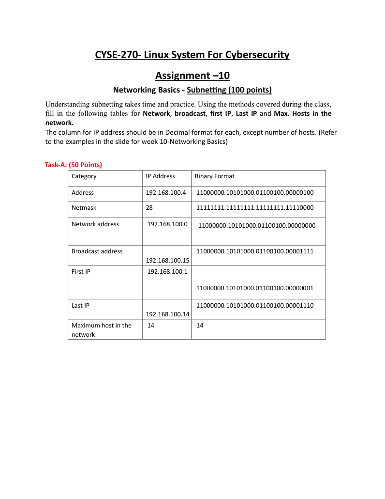
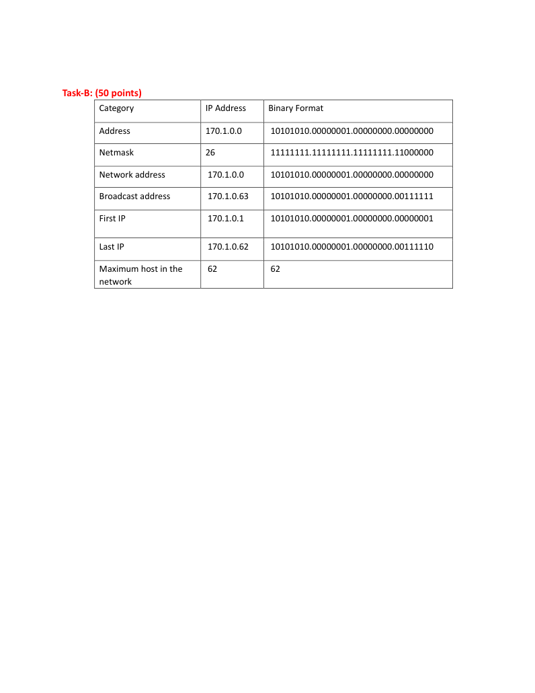
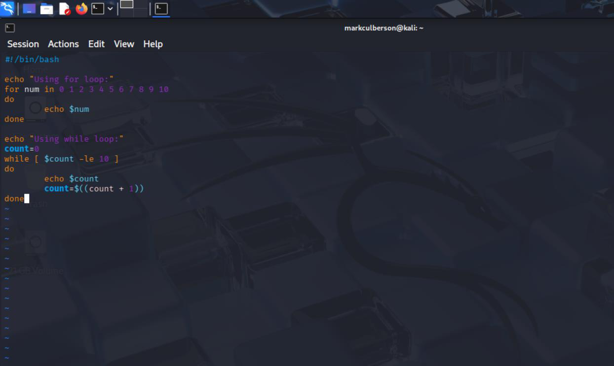

# IPv4 Subnetting and Address Planning

**Course:** CYSE 270 — Linux System for Cybersecurity, Old Dominion University  
**Evidence type:** Screenshots extracted from a submitted coursework PDF.  
**Source:** `Assignment 10 - Networking Basics and Subnetting (1)(1).pdf` (not included in this public-facing package).

## Project overview
Calculated network and broadcast addresses, usable address ranges, host counts, and binary representations for /28 and /26 IPv4 networks.

## Technical observations
The completed tables show 192.168.100.0/28 with 14 usable hosts and 170.1.0.0/26 with 62 usable hosts. These calculations support secure network segmentation and IP planning.

## Evidence gallery

## Evidence and limitations
This description was drafted from the submitted PDF and its screenshots. It is a portfolio explanation, **not** a verbatim original lab reflection. Any screenshots may show mistakes or intermediate states; they are not proof of production readiness. Original editable source files were not provided.

**Before publication:** inspect all images for usernames, student IDs, passwords, hashes, network identifiers, and other sensitive details. Remove or redact as needed.
