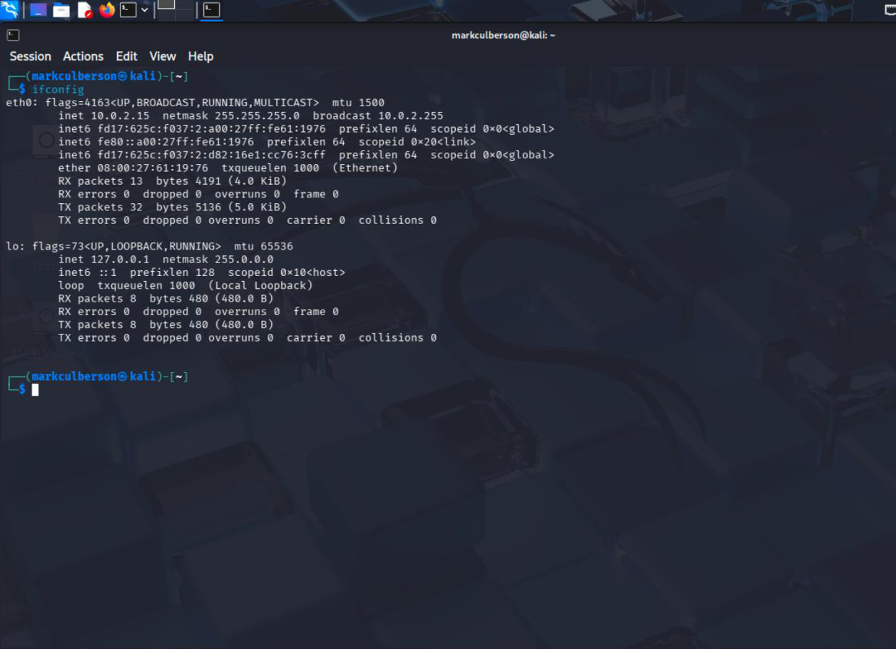
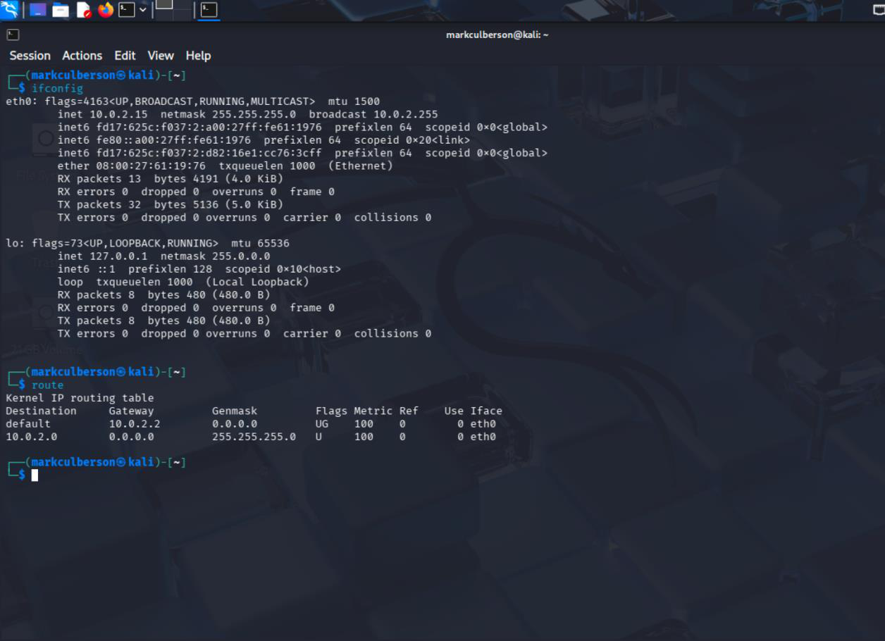
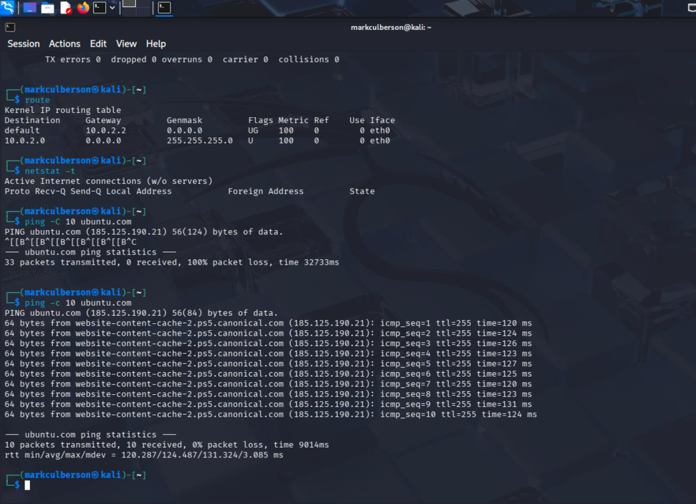
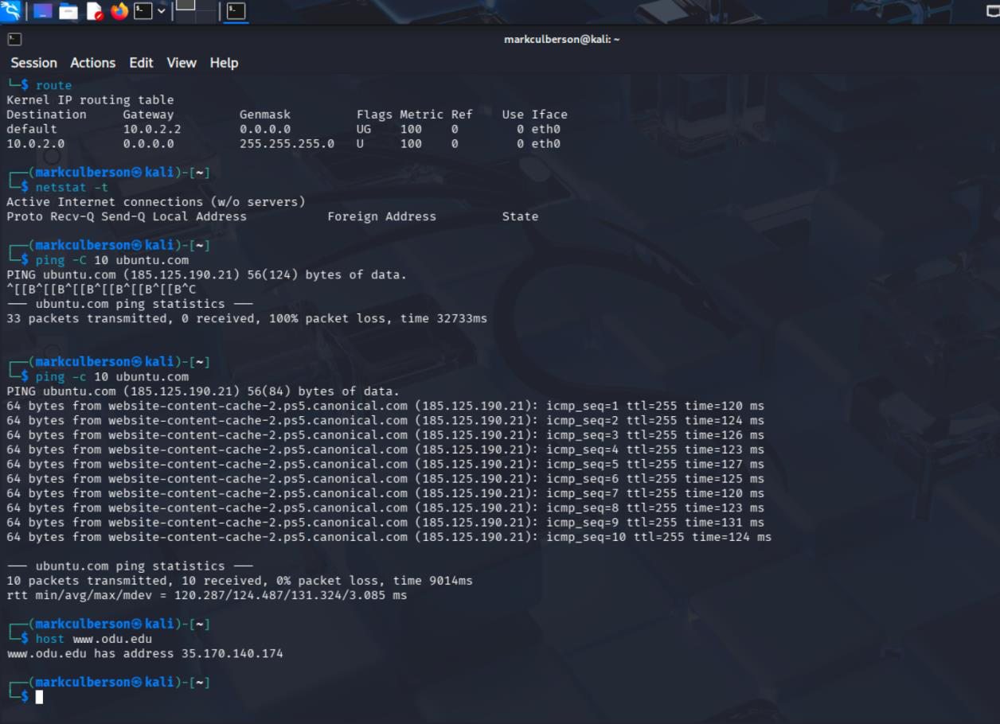

# Linux Network Configuration and Diagnostics

**Course:** CYSE 270 — Linux System for Cybersecurity, Old Dominion University  
**Evidence type:** Screenshots extracted from a submitted coursework PDF.  
**Source:** `Lab 11 Network Basics Configuration (1)(1).pdf` (not included in this public-facing package).

## Project overview
Inspected interface configuration, routing, TCP connections, DNS, and connectivity, then compared virtual network modes.

## Technical observations
The captured ping test shows an initial unsuccessful attempt followed by a ten-packet test with replies, illustrating how command options and diagnostic iteration affect results.

## Evidence gallery

## Evidence and limitations
This description was drafted from the submitted PDF and its screenshots. It is a portfolio explanation, **not** a verbatim original lab reflection. Any screenshots may show mistakes or intermediate states; they are not proof of production readiness. Original editable source files were not provided.

**Before publication:** inspect all images for usernames, student IDs, passwords, hashes, network identifiers, and other sensitive details. Remove or redact as needed.
